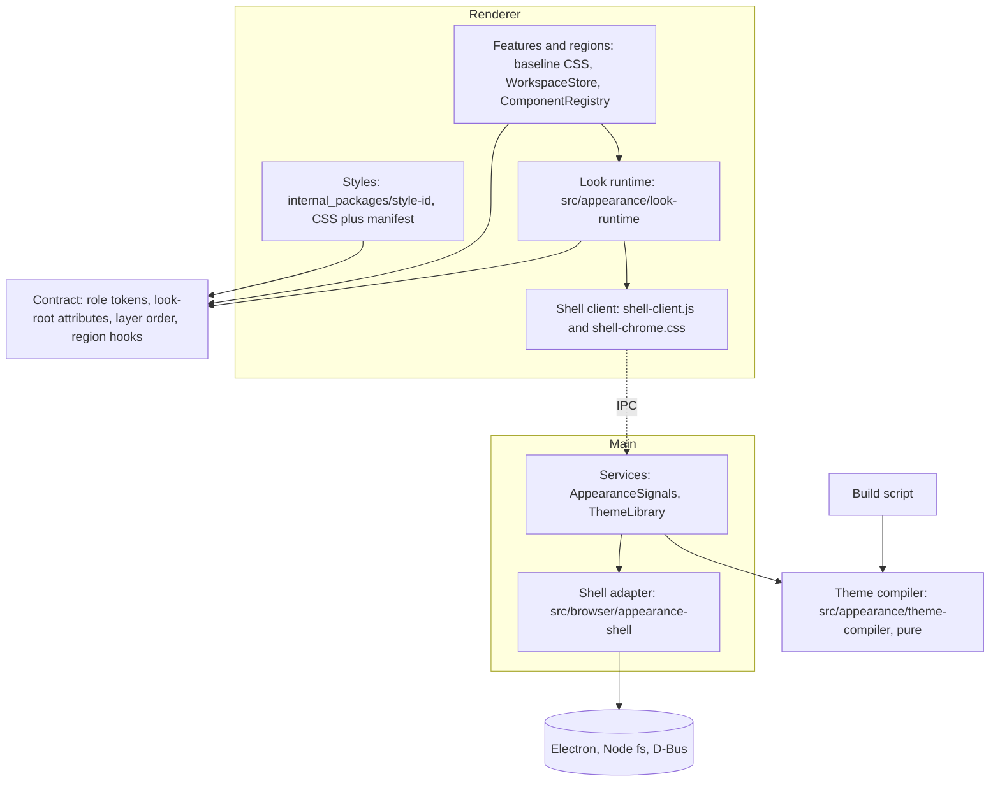
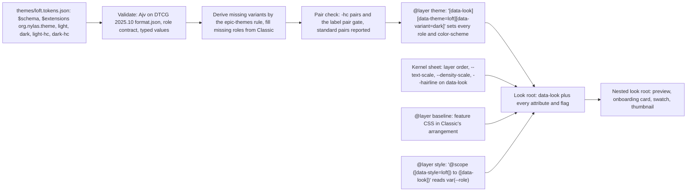
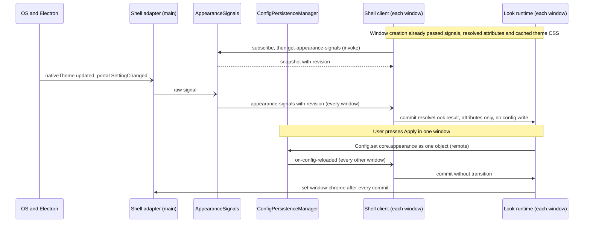
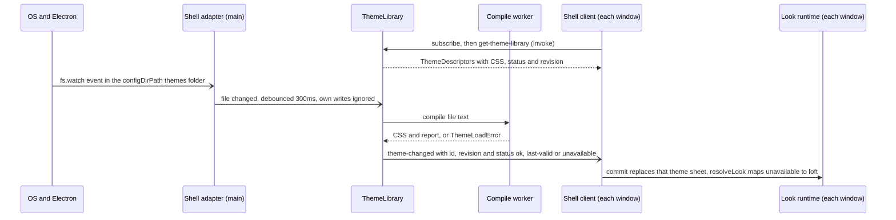

# Architecture Spine — theme-and-style-system

## Design Paradigm

**Token pipeline + plugin (microkernel) styles behind a shell adapter (ports and adapters).**

- **Token pipeline:** `.tokens.json` → theme compiler → attribute-keyed CSS custom properties in `@layer theme`. One compiler, run at build for built-ins and at load for third-party files.
- **Microkernel:** the kernel is the role-token contract, the look-root attributes, the cascade-layer order, the seven regions and Classic's baseline arrangement. Styles are CSS-plus-manifest packages that override the baseline. Features register into regions, never into styles.
- **Ports and adapters:** every OS touch point sits behind one shell adapter, with a main half and a renderer client. Theme, style and feature code stays shell-neutral.

| Layer | Lives in | May depend on |
| --- | --- | --- |
| Styles (CSS + `nylasStyle` manifest) | `internal_packages/style-<id>/` | role tokens, look-root attributes, region hooks, adapter-set custom properties |
| Features and regions (baseline CSS) | `internal_packages/*`, `src/sheet.jsx`, `WorkspaceStore`, `ComponentRegistry` | look runtime, role tokens, data provider |
| Look runtime | `src/appearance/look-runtime/` | shell client, theme CSS, config, style manifests |
| Theme compiler | `src/appearance/theme-compiler/` | culori, Ajv, the DTCG format schema; nothing else |
| Services (main) | `src/browser/appearance-services/` | shell adapter, theme compiler |
| Shell adapter | `src/browser/appearance-shell/` (main), `src/appearance/shell-client.js` + `shell-chrome.css` (renderer) | Electron, Node, D-Bus |

## Invariants & Rules



Arrows read "depends on". Only the shell adapter reaches Electron, Node fs or D-Bus. Styles depend on the contract only, never on feature code.







### AD-1 — Looks are attribute-keyed CSS on look roots [ADOPTED]

- **Binds:** R1, R2, R9, R10, R12, R13, R14; epic-token-platform, epic-style-contract, epic-loft, epic-appearance, epic-themes, epic-classic-style, epic-taiga-style, epic-darkside-style, epic-less-is-more-style, epic-style-api, epic-onboarding-upgrade
- **Prevents:** per-window and per-preview recompiles; style rules bleeding into nested previews; nested roots inheriting the window's resolved values.
- **Rule:** Theme CSS is keyed only on `[data-look][data-theme][data-variant]`. Style CSS lives only inside `@scope ([data-style="<id>"]) to ([data-look])`. Every built-in theme and style sheet stays resident in every window (AD-28). Switching or previewing a look changes look-root attributes only. A sheet is added, replaced or removed only when a theme file is installed, changed or removed (AD-16). Everything a look depends on (derived roles, `--text-scale`, `--density-scale`, `--hairline`) is declared on `[data-look]` by attribute selector in theme or kernel CSS, never on `:root` or in inline style. Every look root carries the full attribute set, signal flags included, filled by `resolveLook` (AD-23). Look roots take `dir` from the window's document (`ltr` today). Flag-keyed CSS in any layer is written `:scope[data-…]`, inside the style's scope or inside `@scope ([data-look]) to ([data-look])`; lint enforces it. The per-window LESS compile in `StyleManager` / `<nylas-styles>` goes (AD-35).

### AD-2 — One shell adapter owns every OS touch point [ADOPTED]

- **Binds:** R13, R14, R15, R16, R17, R20, R24, R25; epic-token-platform, every epic
- **Prevents:** a later shell move rewriting the theme system; Electron calls spread across theme, style and feature code; Chromium-only CSS in style packages.
- **Rule:** Appearance signals, window chrome, file watching, the themes folder, the last-valid cache, file dialogs, the print window and font serving go through the shell adapter only: `src/browser/appearance-shell/` in main, `src/appearance/shell-client.js` in the renderer. No file under `src/appearance/` except `shell-client.js` imports `electron` or `@electron/remote`, and no style package does. Theme, style and feature CSS uses only features in Chromium 156 and the shell-neutral floor, Safari / WKWebView 26 and WebKitGTK 2.50 (the WebKitGTK check of `@scope` and `contrast-color()` belongs to the platform-move research, https://github.com/heyjawrsh/nylas-mail/issues/6). Window-chrome CSS (`env(titlebar-area-*)`, `app-region`) lives only in the adapter's own `shell-chrome.css`; styles read the adapter-set custom properties (AD-15). `nativeTheme.themeSource` stays `system`; Mode reaches CSS through `color-scheme` on look roots, set by theme CSS per variant. Font serving moves from the deprecated `registerFileProtocol` to `protocol.handle` behind the adapter (AD-17).

### AD-3 — The platform move is its own initiative [ADOPTED]

- **Binds:** all; every epic
- **Prevents:** shell-migration work or shell-specific APIs leaking into theme and style epics.
- **Rule:** No epic here adds Tauri or native-shell work. The shell decision belongs to a separate initiative that starts with bmad-deep-recon on the state-of-the-art track. This spine stays shell-neutral (AD-2).

### AD-4 — Ship on Electron 45 [ADOPTED]

- **Binds:** R11, R13, R14, R20; epic-platform-baseline, every release
- **Prevents:** shipping on 44.x past its end of life (about 2027-03-02).
- **Rule:** epic-platform-baseline moves the app from Electron 44.0.0 to the latest 45.x patch (Chromium 156). Each release ships on a supported Electron major until the platform initiative decides the shell. Node follows the Electron major (24 on 45; 46 moves to 26).

### AD-5 — One in-house theme compiler [ADOPTED]

- **Binds:** R4, R5, R14, R23, R26; epic-token-platform, epic-loft, epic-themes, epic-theme-authoring
- **Prevents:** built-in and third-party themes compiling through different paths; two derivation algorithms; quietly fixed standard-contrast ratios.
- **Rule:** `src/appearance/theme-compiler/` is the only code that turns `.tokens.json` into CSS. It runs at build time for built-ins and, for third-party files, in a worker owned by the main-process ThemeLibrary, never per window. It is pure: file text in, CSS plus a report out, with no fs, DOM or Electron access. It validates with Ajv against the pinned format schema `https://www.designtokens.org/schemas/2025.10/format.json`, the role contract and the EXPERIENCE Theme Authoring value rules, and serialises only typed values (AD-31). Every report entry carries the line of the token that caused it. It fills missing roles from Classic and appends the system fallback stack to every emitted font family. It holds the one derivation implementation: missing variants follow the whole-mode rule epic-themes decides (Open Questions), and re-derived pairs follow DESIGN › Derived values and nothing else. Derivation is deterministic: the same file and compiler version give byte-identical CSS. Contrast gate: a built-in fails the build if it needs any derivation, if any `-hc` pair fails, or if any variant fails `text-strong` on `surface-panel` at 4.5:1 (the Increase contrast label pair). Standard-contrast pair failures are reported, never fail a build or a load, and are never re-derived. A third-party file has failing `-hc` pairs and a failing label pair re-derived and badged. No Terrazzo, no Style Dictionary.

### AD-6 — A theme file holds four variant groups [ADOPTED]

- **Binds:** R4, R5, R14, R23, R26; epic-token-platform, epic-loft, epic-themes, epic-theme-authoring
- **Prevents:** themes expressing mode × contrast in different shapes; a dependency on the DTCG Resolver module; files failing the official schema.
- **Rule:** One `.tokens.json` per theme: `"$schema": "https://www.designtokens.org/schemas/2025.10/format.json"`, `$extensions["org.nylas.theme"]` holding `id`, `name`, `author`, `version`, `license`, and the top-level groups `light`, `dark`, `light-hc` and `dark-hc`. The group names are the `data-variant` values. Built-ins ship all four groups complete; Classic's four, `-hc` included, ship in epic-token-platform. A third-party file's missing groups are derived at load (AD-5). Role name = the DTCG path joined with `-`; two paths resolving to one role is a `schema` error. Line height and letter spacing are DTCG `number` (letter spacing read as em). A shadow role set to none is an empty array. Unknown tokens are reported and ignored. The DTCG Resolver module is not used.

### AD-7 — Internal package styling is plain CSS on role tokens [ADOPTED]

- **Binds:** R2, R3, R19, R28; epic-token-platform, epic-style-contract (lint), epic-taiga-style, epic-darkside-style, epic-less-is-more-style
- **Prevents:** two authoring languages; LESS colour functions baking theme values in at compile time; RTL breaking in shared CSS; a LESS compiler shipping to build internal CSS.
- **Rule:** All internal package and `static/` LESS is ported to plain CSS that reads role tokens through `var()`, generated through the legacy map (AD-29). epic-token-platform ports every stylesheet the app loads, and from then on nothing compiles LESS at build or run time (AD-35). Ported feature CSS is the baseline layer (AD-20, AD-22), uses logical properties and keys motion on `data-reduced-motion`, under the same lint as style CSS. No legacy LESS theme loads (AD-30). The layout LESS in `ui-taiga`, `ui-darkside` and `ui-less-is-more` is not loaded after epic-token-platform and is ported to CSS in the matching style package by epic-taiga-style, epic-darkside-style and epic-less-is-more-style.

### AD-8 — Third-party plugin LESS compiles through a shim [RETIRED]

- **Status:** Retired (superseded 2026-11-12, see AD-35).
- **Binds:** nothing; R28 is governed by AD-35, AD-29 and AD-30.
- **Prevents:** nothing; kept so AD ids stay stable.
- **Rule:** Retired. No shim, no `ui-variables` injection and no LESS function plugin ship; see AD-35.

### AD-9 — Styles are CSS-only packages that arrange seven regions [ADOPTED]

- **Binds:** R2, R3, R6, R7, R8, R15, R19, R21, R27; epic-style-contract, epic-loft, epic-classic-style, epic-taiga-style, epic-darkside-style, epic-less-is-more-style, epic-style-api
- **Prevents:** per-style component forks; styles naming a theme, a hex or a role value; style packages running code; npm `"style"` string fields being read as styles.
- **Rule:** A style is a package whose `package.json` has a `"nylasStyle"` object (see Consistency Conventions), with CSS inside `@scope` (AD-1) that the loader wraps in `@layer style` (AD-22). The package loader never runs JavaScript from a style package. Regions map onto WorkspaceStore locations: nav = `RootSidebar`, list = `ThreadList` / `DraftList`, reading = `MessageList` and `Center`, rail = `MessageListSidebar`, titlebar = the one top-bar container carrying `data-region="titlebar"` over the sheet `Toolbar` locations, plus two fixed locations defined in `_resetInstanceVars`, `Overlay` and `Toast`, whose hosts the sheet container renders. Preferences sits outside region arrangement. A region in the manifest `hide` is not mounted by WorkspaceStore; it wins over `core.workspace.hiddenLocations` without writing it. Features register components into regions through `ComponentRegistry.register` with `location(s)` / `role(s)` and `mode(s)`, never into a style. The notifications bell registers into `titlebar` under a role; Loft positions that slot and ships no placeholder. Style CSS reads only role tokens and may declare only `--radius-*`, `--space-*`, `--row-height-*` and `--style-*` properties. A hex literal, a theme id, a physical `left` / `right` property or a declared role property fails `pnpm lint` (a script over `internal_packages/style-*/` and all ported CSS); the loader runs the same check on community styles and refuses a failing one with an error toast (AD-24 fallback).

### AD-10 — Row height comes from style CSS, read by a probe per look root [ADOPTED]

- **Binds:** R3, R6, R8, R16, R18; epic-style-contract, epic-loft, epic-classic-style, epic-taiga-style, epic-darkside-style, epic-less-is-more-style, epic-appearance
- **Prevents:** per-row measurement; stale `itemHeight` after a resize, font load or text-size change; previews showing the window's row height; text scale applied twice.
- **Rule:** Each style defines `--row-height-<list>` per density on `:scope[data-density=…]`, as a `calc()` over its spacing roles and the theme's pre-scaled type sizes and unitless line heights; it never multiplies by `--text-scale` again. "Natural height" means this value: derived from type and padding, constant per look and list width. A narrow-list height is a container query on the list container in style CSS. The baseline layer supplies a default for every `--row-height-<list>`, so `ListTabular` never reads an empty value. A probe lives in each list's own region container inside its own look root, and is read with `getComputedStyle` on a hidden sized element. It is re-read on a look change for that root (`data-style`, `data-density`, `data-text-size`, `data-font`, `data-variant`), on `document.fonts` `loadingdone`, and on a `ResizeObserver` callback for the list container. `ListTabular` and `multiselect-list.jsx` keep fixed-height virtualisation (`itemHeight`, rows at `idx * itemHeight`). Loft's overhanging selected card is drawn outside the row box, never through `itemHeight`. The hard-coded heights go: thread-list 36 / 85 below 540px (the JS width branch), draft-list 39. Every message row resolves to at least 24px.

### AD-11 — Appearance settings live under `core.appearance` [ADOPTED]

- **Binds:** R1, R10, R12, R16, R17, R22, R28; epic-token-platform, epic-appearance, epic-email-dark-mode, epic-onboarding-upgrade
- **Prevents:** new settings colliding with `core.themes`; windows applying a look in different ways; derived state persisted as user intent.
- **Rule:** New keys go under `core.appearance` (see Consistency Conventions). `core.themes` is left untouched. `core.workspace.interfaceZoom` stays separate and stacks on top of text size through `webFrame.setZoomFactor`. `core.workspace.mode` keeps working in every style whose `layoutMode` is `user`. Config stays owned by the main process (`config.json`). Only an explicit user action writes config, in the window where it happened: an immediate setting writes its key, Apply writes `core.appearance` as one object (AD-26). OS signals, fallbacks and theme removal never write config (AD-23, AD-24). Main broadcasts `on-config-reloaded`, and every other window commits the change through its look-transaction queue. Pending Appearance picks live in `AppearanceDraft` (AD-12) and are never written before Apply. `core.appearance.textSize` starts at 1 (100%) on every OS: Electron exposes no OS text-scale API, so nothing reads one; the onboarding looks step offers the control (user decision 2026-11-12).

### AD-12 — Other epics extend Appearance through one slot, a draft store and card extension points [ADOPTED]

- **Binds:** R9, R10, R22, R25, R26, R27, R29; epic-appearance, epic-email-dark-mode, epic-theme-authoring, epic-style-api
- **Prevents:** several epics editing the Appearance tab's layout, pickers or apply bar; sections writing config directly; undefined section order.
- **Rule:** epic-appearance owns the page layout, the pickers and the apply bar. It exports an `AppearanceDraft` store with `pending`, `applied`, `set(key, value)` (pending keys only), `applyNow(key, value)` (immediate keys only) and `onChange`; it is the only way a section or card extension reads or writes looks. Sections register with `role: "Preferences:Appearance:Section"` and an `order`. epic-appearance adds `order` to `ComponentRegistry` and to `InjectedComponentSet` sorting. Its own sections take orders 100, 200 and up; contributed sections use documented bands between them, with ties broken by package name. Card extension points `Preferences:Appearance:ThemeCard:Accessory` and `Preferences:Appearance:StyleCard:Accessory` receive `{ descriptor }`, so epics 10 and 11 never edit the pickers.

### AD-13 — Apply cross-fades through a View Transition [ADOPTED]

- **Binds:** R9, R11; epic-appearance, epic-token-platform
- **Prevents:** the cross-fade starting before the new look has painted; ad hoc fade code; focus loss on Apply.
- **Rule:** Apply runs `document.startViewTransition` around a look-transaction commit (AD-26), so the fade starts from a snapshot after the new look, its rows and its font have painted. When `data-reduced-motion` is set, no transition runs and the attributes change directly. Apply never moves focus. The look runtime owns one polite live region that announces the whole new look. Other windows commit with no transition. The preview cross-fade is an element-scoped View Transition on the preview root, or a CSS opacity cross-fade if Chromium 156 lacks element-scoped transitions (verify in epic-appearance).

### AD-14 — One main-process AppearanceSignals service [ADOPTED]

- **Binds:** R13, R14, R15, R19; epic-token-platform
- **Prevents:** windows disagreeing about OS appearance; per-OS detection logic in renderers; `-hc` and forced colours fighting on Windows.
- **Rule:** AppearanceSignals in main owns `colorScheme`, `contrast`, `forcedColors`, `reducedMotion` and `reducedTransparency`, read from the per-OS sources in Consistency Conventions. On any change it broadcasts one revisioned `appearance-signals` message to every window. Renderers never call `nativeTheme` or `matchMedia` for these. Linux contrast comes from the XDG portal `org.freedesktop.appearance` `contrast` key (D-Bus `ReadOne` + `SettingChanged`), else the GTK theme-name heuristic, else `unknown`, and the user can set On. GNOME high contrast selects the `-hc` variant through Increase contrast Follow system, not forced colours; Chromium never enables forced colours on Linux. Forced colours beat `-hc`: on Windows, when a Contrast theme is active, `forcedColors` is on, `contrast` is not taken from `shouldUseHighContrastColors`, and `resolveLook` sets `data-forced-colors` without switching to `-hc`. A test-only override (AD-19) is compiled out of release builds.

### AD-15 — The window is frameless on every OS [ADOPTED]

- **Binds:** R6, R20; epic-style-contract, epic-loft, epic-classic-style, epic-taiga-style, epic-darkside-style, epic-less-is-more-style
- **Prevents:** each style solving window controls, drag regions and per-OS placement on its own; Chromium-only chrome CSS in styles; traffic lights stuck at the old style's height.
- **Rule:** `titleBarStyle: 'hidden'` on every OS for every window `window-launcher.js` opens, popouts included, replacing `frame: process.platform !== "darwin"` in `window-launcher.js`. Windows and Linux use `titleBarOverlay` (Window Controls Overlay); macOS keeps its traffic lights. The adapter's `shell-chrome.css` owns `env(titlebar-area-*)` and `app-region: drag` / `no-drag` on `[data-region=titlebar]` and its interactive descendants, and publishes `--titlebar-inset-start`, `--titlebar-inset-end` and `--titlebar-area-height` on the window look root for every OS. Styles place the top bar from those properties only. Window-control placement follows the OS, not the app's `dir`. One renderer → main channel, `set-window-chrome` (`height`, `buttonPosition`, `color`, `symbolColor`; colours as `#rrggbb` resolved in the renderer; sizes in DIP after `interfaceZoom`), is sent after every commit and by a hot window on activation. macOS uses `trafficLightPosition` at creation and `setWindowButtonPosition` for live moves; Windows and Linux use `setTitleBarOverlay`, where Linux ignores `symbolColor`. `ToolbarWindowControls` and the feature `process.platform` chrome checks go. The onboarding window stays 900×600 and frameless.

### AD-16 — The main process watches the themes folder with `fs.watch` [ADOPTED]

- **Binds:** R23, R24, R25; epic-token-platform, epic-theme-authoring
- **Prevents:** a native or ESM watcher dependency; each window watching files on its own; dev and spec runs touching the user's themes; stale caches after an update.
- **Rule:** The main-process ThemeLibrary watches the flat folder `<configDirPath>/themes/` (so `.nylas-dev`, `.nylas-spec`, `.nylas-bench`, `--config-dir-path` and `NYLAS_HOME` each get their own) with non-recursive Node `fs.watch` through the adapter, debounced 300ms per file. The folder is created on the first install or export, not on first launch. The watcher starts when the folder exists (at startup, after ThemeLibrary creates it, or on a parent-folder event) and re-arms if the folder is re-created. Events resolve to the final `*.tokens.json` name, so atomic saves through temporary names count once. ThemeLibrary ignores events for its own writes within the debounce window, probes writability at startup and on every install or export, compiles the changed file (AD-5) and broadcasts `theme-changed`. No chokidar, `@parcel/watcher` or `pathwatcher`. ThemeLibrary also owns install, export and remove (AD-33) and the last-valid cache: written only after a full compile succeeds, each entry keyed by file hash, compiler version and contract version, a mismatch recompiling from the file.

### AD-17 — Bundled fonts come from Fontsource and are served by the adapter [ADOPTED]

- **Binds:** R5, R8, R17; epic-platform-baseline, epic-token-platform, epic-loft, epic-themes, epic-appearance
- **Prevents:** proprietary faces in the public build; each theme bundling fonts its own way.
- **Rule:** Bundled faces come from the Fontsource packages in Stack and are served by the shell adapter through `protocol.handle` on a `nylas://fonts/<id>/…` route mapped to the package directory, reachable from inside the asar. The proprietary `nylas-private-fonts` package is committed to the repo (https://github.com/heyjawrsh/nylas-mail/issues/5); from epic-platform-baseline on, the public build excludes it at packaging time, and a CI check fails if a `Proprietary` package reaches a public artifact. The `email-frame.less` references to `Nylas-Pro` go with the port. Nylas-Pro appears only when that package is present. A face that fails to load falls back to the theme default with a toast (R17). An installed-font pick is stored as its family name, sets `data-font="custom"`, and the look runtime writes the family as an escaped string into a look-sheet rule on `[data-look][data-font="custom"]`; installed-font enumeration and missing-font detection go through the adapter.

### AD-18 — Email dark adaptation honours sender dark styles [ADOPTED]

- **Binds:** R22; epic-email-dark-mode
- **Prevents:** double-darkening mail that already ships dark styles; altered images; adapted colours leaking into replies or print; adaptation loading remote resources.
- **Rule:** A body that declares `prefers-color-scheme: dark` rules or a `color-scheme` that includes `dark` in its inline styles renders as authored, unless it fails the active contrast floor; then it is adapted. Adaptation activates sender dark rules explicitly (rewriting the `@media (prefers-color-scheme: dark)` blocks), never relying on the iframe's media query following the app. A body that declares nothing is adapted with a luminance-threshold rewrite of text and backgrounds, in the style of Thunderbird's DarkReader.mjs. Images are never altered. Adaptation never loads a resource; a transparent-image backing plate is chosen by image format, or after the user unblocks the image. The `invert()` + `hue-rotate` rules in ui-dark go. Adaptation never mutates the message model body, and replies and forwards keep quoting the model body. Print renders the model body in a print window opened through the shell adapter with a pinned `{ variant: light, contrast: off }` look. The epic-email-dark-mode spike validates the algorithm details.

### AD-19 — Verification runs on the real Electron app with Playwright [ADOPTED]

- **Binds:** R7, R14, R32; epic-platform-baseline (harness core, CI gate), epic-style-contract (sweep, thresholds, first performance budgets), every epic
- **Prevents:** verifying in a test harness instead of the shipped app; contrast checked from screenshots; signals emulated where the app never reads them.
- **Rule:** Playwright drives the real built Electron app on a temporary config dir, with `@axe-core/playwright` running on the high-contrast variants. From epic-platform-baseline on, this harness replaces `smoke.js` (which passes on a timer) as the CI gate. Signals are driven through AppearanceSignals' test-only override (env var or launch flag), never `page.emulateMedia`; the sweep covers `contrast`, `forcedColors`, `reducedMotion` and `reducedTransparency`. CI on Linux runs the 540-combination screenshot and overflow sweep and opens every window type (main, composer popout, thread popout, onboarding, print). RTL: the sweep forces `dir="rtl"` once per style at its native theme across every window type, not across all 540 combinations. Fixtures prove that `@scope (…) to ([data-look])` never treats the scoping root as its own limit, and that the email frame runs no script and fetches no remote CSS. By-eye checks run per OS. The theme compiler checks contrast pairs directly at build and at load. The packager must keep the `EnableNodeCliInspectArguments` fuse on for test builds.

### AD-20 — Classic is the baseline arrangement in a low cascade layer [ADOPTED]

- **Binds:** R3, R6, R7, R27; epic-token-platform, epic-style-contract, epic-classic-style, epic-taiga-style, epic-darkside-style, epic-less-is-more-style, epic-loft, epic-style-api
- **Prevents:** uncovered features having no CSS under a community style; reopening Classic's frozen CSS in epic-style-api; missing row heights reaching `ListTabular`.
- **Rule:** Every feature's own CSS is Classic's arrangement in `@layer baseline`, keyed on `[data-region]` and feature hooks, never on `data-style="classic"`. A style overrides it in `@layer style` only for the features it lists in `covers`, so uncovered features render in Classic automatically. The `style-classic` package holds only its manifest and what Classic does differently from the baseline, ideally nothing. `covers` lists feature hook names, one per registered region component; the vocabulary freezes with the shared kit at the end of epic-classic-style.

### AD-21 — Style geometry lives in the manifest [ADOPTED]

- **Binds:** R3, R6, R8, R21; epic-style-contract, epic-loft, epic-classic-style, epic-taiga-style, epic-darkside-style, epic-less-is-more-style, epic-appearance
- **Prevents:** feature JS pinning column widths and the window minimum so the reflow ladder never fires; each style inventing its own geometry workaround.
- **Rule:** Each style's manifest declares region min and max widths, the window minimum width and the reflow-ladder breakpoints. A style-geometry runtime in epic-style-contract applies them: `ResizableRegion` takes the manifest widths, the window minimum is set through the shell adapter, and `containerStyles` min/max and the `sheet.jsx` `setMinimumWidth` sum stop applying to styled regions. `layoutMode: split` forces split in WorkspaceStore memory, never writes `core.workspace.mode`, and hides the mode switch. Below the window minimum, the runtime sets `data-reflow="<step>"` on the look root from the manifest breakpoints; style CSS reacts on `:scope[data-reflow=…]`, and WorkspaceStore switches to single-pane-with-Back at that step. The manifest is the only source of these numbers. The Appearance preview renders at a virtual window width with the pending style's geometry and is scaled with `transform`, so it never enters the ladder. Styles stay CSS plus data.

### AD-22 — One cascade-layer order

- **Binds:** R2, R17, R19, R28; epic-token-platform, epic-style-contract (lint), every style epic, epic-style-api, epic-onboarding-upgrade
- **Prevents:** unscoped feature CSS beating scoped style CSS on specificity; insertion order deciding the look; a different specificity hack per style; a layer kept for a user stylesheet nothing loads.
- **Rule:** A kernel sheet declares `@layer reset, kernel, theme, font, baseline, style, plugin;` before any other sheet. The theme compiler emits `@layer theme`; the font override goes in `font`; ported feature CSS goes in `baseline` (AD-20); style packages go in `style`; a third-party package's plain CSS goes in `plugin`. There is no `user` layer: `styles.less` is dropped (AD-35). The package loader wraps each package sheet in its layer by source, so authors never write `@layer`. Sheets loaded outside the loader declare their layer, and the style lint (epic-style-contract) fails unlayered CSS in `internal_packages/` and `static/`.

### AD-23 — The resolved look is computed, never stored

- **Binds:** R1, R10, R13, R14, R15; epic-token-platform, epic-appearance, epic-onboarding-upgrade
- **Prevents:** every window writing config on one OS signal; Mode Auto silently becoming Light or Dark; windows disagreeing on the derived look.
- **Rule:** `data-variant`, `data-increased-contrast`, the signal flags and every other look-root attribute come from one pure function, `resolveLook(appliedConfig, overrides, signals, library)` in `look-runtime/`, called for every look root. Overrides are a nested root's pending or pinned values (preview, onboarding card, swatch, print). OS signals and fallbacks never cause a config write.

### AD-24 — ThemeLibrary alone decides theme fallback, at render time

- **Binds:** R17, R24, R25, R27; epic-token-platform, epic-style-contract, epic-appearance, epic-theme-authoring, epic-style-api
- **Prevents:** a broken or removed theme overwriting the user's choice; windows falling back differently; Apply committing a fallback id.
- **Rule:** Config and `AppearanceDraft` always hold the user's chosen ids. ThemeLibrary alone decides what CSS each theme id resolves to, and every `theme-changed` carries `status`: `ok`, `last-valid` or `unavailable`. Fallback order is the last-valid cached CSS, then Loft. `resolveLook` maps `unavailable` to `loft` at render time in every look root alike; fixing the file restores the theme. A file deleted outside the app keeps its last-valid CSS with an info toast. In-app Remove drops the cache entry, so the render falls back to Loft with a toast and config keeps the id. A missing, disabled or refused style renders the Classic baseline with an error toast, and config keeps its id.

### AD-25 — Windows open with the look resolved, then follow revisioned events

- **Binds:** R13, R14, R24, R25; epic-token-platform, epic-theme-authoring, epic-onboarding-upgrade
- **Prevents:** a flash of the wrong variant on first paint; late-opened windows missing third-party theme CSS; an old snapshot overwriting a newer event; each epic adding its own catch-up channel.
- **Rule:** Main passes the signals snapshot, the resolved look-root attributes and every third-party theme's CSS from the last-valid cache with window creation, through load settings, so no compile blocks it. The renderer sets attributes and sheets before React mounts. `BrowserWindow.backgroundColor` is the resolved `surface-app`. ThemeLibrary re-validates in the background and pushes `theme-changed` if the result differs. `get-theme-library` (invoke) returns every `ThemeDescriptor` with CSS, status and the themes-folder state. Every `appearance-signals` and `theme-changed` payload carries a monotonically increasing `revision`. A window subscribes before it asks for a snapshot, and ignores any event or snapshot older than what it holds.

### AD-26 — One look-transaction queue per window

- **Binds:** R10, R11, R16, R24; epic-token-platform, epic-style-contract (row-height re-probe, `set-window-chrome`), epic-appearance
- **Prevents:** a second View Transition cancelling the first; the snapshot capturing stale rows or the fallback font; other windows painting intermediate looks from per-key writes.
- **Rule:** Every look change in a window (Apply, immediate settings, signals, `theme-changed`, `on-config-reloaded`) goes through `lookRuntime.commit(change, { transition })`. Commits are serialised, and changes queued during a transition coalesce into the next commit. A commit sets attributes and sheets, awaits `document.fonts.load` for a changed `data-font`, re-probes row heights (AD-10), flushes React with `flushSync`, sends `set-window-chrome`, emits `look-changed`, then resolves. Apply is a single-object write, `Config.set('core.appearance', next)`, so every other window gets one `on-config-reloaded` and one commit.

### AD-27 — The email frame is locked down and bound explicitly [ADOPTED]

- **Binds:** R16, R22; epic-token-platform (minimal binding), epic-email-dark-mode
- **Prevents:** sender HTML running script or fetching remote CSS; frames losing styles when `<nylas-styles>` stops being the theme path; frames going stale on a look change; clipped bodies after a text-size change.
- **Rule:** The frame gets its look only through an explicit binding owned by `src/appearance/email-frame/`. epic-token-platform ships it minimal: the frame's `<html>` carries `data-look` and the resolved attributes, and the binding writes `color-scheme`, the resolved role values and the ported `email-frame.css` into it. It never scrapes app sheets; `EmailFrameStylesStore` stops scraping them. On `look-changed` (AD-26) the binding rewrites the frame and re-measures its height. epic-email-dark-mode adds the lockdown and extends the binding: bodies render in an iframe with `sandbox` lacking `allow-scripts`, a strict CSP and no remote CSS fetch; sanitising, then adaptation (AD-18), run on the HTML before it is written; on `look-changed` the binding also re-runs adaptation.

### AD-28 — Look sheets load in every window type

- **Binds:** R7, R12, R32; epic-token-platform, epic-style-contract, every style epic, epic-onboarding-upgrade
- **Prevents:** onboarding cards and popouts rendering unstyled because a package's `windowTypes` gate skipped them; a hot window painting unstyled, then snapping.
- **Rule:** The look runtime loads style packages, not the `windowTypes` gate; a `nylasStyle` block implies every window type. The hot-window bootstrap loads look sheets eagerly and re-applies the look and window chrome on activation.

### AD-29 — One generated legacy-variable map

- **Binds:** R2, R28, R29; epic-token-platform, epic-theme-authoring
- **Prevents:** the port codemod and the author guide spelling one legacy variable two ways; map entries pointing at roles the compiler never emits.
- **Rule:** `src/appearance/legacy-map.json` is generated from DESIGN's LESS variable → role table. Each of the 137 legacy variables gets `kind` (`colour`, `dimension` or `font`) and `css` (a `var(--role)` or `color-mix(…)` expression for colours, a literal Classic value for dimensions, and for font sizes a `var(--type-<role>-size)` type role, which the compiler emits pre-scaled by `--text-scale`, so ported text follows Text size). The port codemod (AD-7) is built from it, and the theme and plugin author guide (R29) publishes it, so plugin authors port their LESS to CSS on role tokens (AD-35). A test asserts that every `css` value references only roles the compiler emits.

### AD-30 — No legacy LESS theme loads; the upgrade mapping runs once

- **Binds:** R28; epic-token-platform, epic-themes, epic-onboarding-upgrade
- **Prevents:** a legacy LESS theme and the token look stacking in undefined order; an upgrader landing on an unported look; windows racing to migrate settings.
- **Rule:** From epic-token-platform on, only the token look renders. No legacy LESS theme loads, built-in or community (AD-35). Built-in legacy ids in `core.themes` (`ui-light`, `ui-dark`, `ui-taiga`, `ui-darkside`, `ui-less-is-more`, `ui-ubuntu`) are read only by the upgrade mapping. Main runs the mapping once, before the first window is created, when `core.themes` exists and the mapping marker is absent. It maps per EXPERIENCE › Upgrade; a built-in legacy id whose ported theme has not shipped yet lands on Classic until epic-themes ships that port. It writes only `core.appearance.*` and the marker, and never writes `core.themes`. Before epic-onboarding-upgrade ships the mapping, a pre-release build with no `core.appearance` renders the default look (Classic until epic-loft ships, then Loft); no interim mapping ships.

### AD-31 — Theme CSS is serialised from typed values

- **Binds:** R8, R23, R26; epic-token-platform, epic-theme-authoring, epic-loft
- **Prevents:** CSS injection from theme files through escapes, comments or braces; an author id spliced raw into a selector or file name; unescaped search-hit markup.
- **Rule:** The compiler parses each value to its typed form (a colour normalised by culori, a number with an allow-listed unit, a weight number, shadow parts, a font-family list) and emits CSS from those parts only; anything else is `forbidden-value`. Font families are emitted as escaped CSS strings. The theme id must match `^[a-z0-9]+(-[a-z0-9]+)*$` before it is used in a selector, a file name or a toast key, else `invalid-id`. `name` is rendered as text only. The EXPERIENCE blacklist stays as defence in depth. Compiled CSS is applied with `CSSStyleSheet.replaceSync` or `textContent`, never `innerHTML`. Search hit markup is built only by the search layer from text it has escaped; components render highlight HTML only from that output and never call `dangerouslySetInnerHTML` on message fields.

### AD-32 — Preview and onboarding render real components on fixture data

- **Binds:** R9, R12; epic-style-contract, epic-loft, epic-classic-style, epic-appearance, epic-onboarding-upgrade
- **Prevents:** preview components reading the user's mail or causing side effects; fake preview components; a refactor of region components in epic-appearance.
- **Rule:** Every component registered into a region reads its data through a provider (React context) that defaults to the live stores. epic-style-contract ships the provider and the fixtures; epic-loft and the frozen kit follow it. The preview and onboarding roots wrap a fixture provider from `src/appearance/preview-fixtures/` and render under `inert`, with no store, action, network or keyboard-command access. Popovers and modals portal into the nearest look root. The mini-preview reuses the same render, scaled, not a second tree.

### AD-33 — Install, export and remove are ThemeLibrary invokes

- **Binds:** R25, R26; epic-theme-authoring, epic-appearance, epic-token-platform
- **Prevents:** rejected files reaching the themes folder; installs applying directly; the file picker bypassing the adapter; a double `theme-changed` for ThemeLibrary's own writes; forked theme identity.
- **Rule:** Install is two invokes: `theme-install-check` (validate, return the report or a clash) → `theme-install-commit` (`replace` or `keep-both` plus a name). A rejected file is never copied, and a built-in id or name clash copies nothing. Keep both derives a new unique id from the given name and rewrites `id` and `name` before writing. `theme-export-copy` and `theme-remove` complete the set. The file dialog goes through the shell adapter. Install never writes config; the renderer makes the theme pending through `AppearanceDraft`. `$extensions["org.nylas.theme"].id` is the identity: ThemeLibrary writes files as `<id>.tokens.json`, loads a file whose name disagrees under its id with a warning, and gives the newer of two files sharing an id a `duplicate-id` error. A parse failure is keyed and named from ThemeLibrary's file → id map of the last valid load, else the file name.

### AD-34 — epic-platform-baseline opens the initiative [ADOPTED]

- **Binds:** R7, R32, every epic's done condition; epic-platform-baseline, epic-token-platform (packaging duties)
- **Prevents:** no epic being able to close without an installable build; React 19 breakage blocking real-app verification; the old Squirrel updater clashing with electron-builder; a LESS compiler packaged into the build; crash dumps leaving the machine.
- **Rule:** epic-platform-baseline is its own opening epic. It moves the app to Electron 45 (AD-4), fixes the React 19 render breakage (https://github.com/heyjawrsh/nylas-mail/issues/7), and adds electron-builder unsigned pre-release builds for macOS, Windows and Linux in CI. The live Squirrel updater code (`main.js` `handleStartupEventWithSquirrel`, `windows-updater.js`, `linux-updater-adapter.js`) is disabled in the same story. Crash dumps never upload from any build (https://github.com/heyjawrsh/nylas-mail/issues/8, user decision); a working crash reporter stays out of scope. It ships the Playwright + axe harness core on the built app as the CI gate (AD-19) and the `nylas-private-fonts` packaging exclusion with its CI check (AD-17). The packaging duties for later code are added by the epic-token-platform stories that introduce that code: the build-time theme compile in the electron-builder build, `static/themes` and the compiled CSS in the asar, `culori` and `ajv` as production dependencies, and the packaged D-Bus client. Fontsource files served from inside the asar land with the bundled-font pipeline (AD-17). LESS removal is not part of the baseline: epic-token-platform removes `less` and `less-cache` after the port (AD-7, AD-35). Signing, notarisation and auto-update are deferred to the modernisation track.

### AD-35 — No LESS anywhere [ADOPTED]

- **Binds:** R2, R28, R29; epic-token-platform, epic-themes, epic-theme-authoring, epic-onboarding-upgrade
- **Prevents:** a LESS compiler shipping only for third-party stylesheets; a second authoring language; legacy LESS themes stacking with the token look; a user-stylesheet path nobody uses.
- **Rule:** No LESS compiler ships. epic-token-platform removes `less` and `less-cache` and `src/less-compile-cache.js`, ports all internal LESS to CSS (AD-7) and drops `ui-variables` injection. The package loader loads only `.css` from a package's `styles/`. A third-party package's `.less` stylesheet is not loaded; the loader logs one deprecation warning per package per launch naming the package, kept local (Consistency Conventions › Theme load error), and the rest of the package loads as before. Plugin authors port to CSS on role tokens with the legacy map published in the author guide (AD-29). No legacy LESS theme loads, built-in or community (AD-30). `styles.less` is neither loaded nor created, and there is no `user` layer (AD-22); custom CSS goes through a CSS-only community style or a theme. `core.themes` is never written. Supersedes AD-8 and the 2026-11-11 legacy-coexistence decision (user decision 2026-11-12).

## Consistency Conventions

| Concern | Convention |
| --- | --- |
| Role custom properties | `--<role>`, using DESIGN frontmatter key names in kebab-case: `--surface-app`, `--text-default`, `--accent-on`, `--category-1` … `--category-8`, `--shadow-card`, `--shadow-soft`, `--shadow-accent`. Never a variant suffix (`-dark`, `-hc`), because the variant is an attribute. Derived roles are declared on `[data-look]`. |
| Typography properties | `--type-<role>-family`, `-size`, `-weight`, `-line-height`, `-letter-spacing` (for example `--type-body-reading-size`). The compiler emits sizes pre-scaled, `calc(<px> * var(--text-scale))`, on `[data-look]`. Consumers never multiply by `--text-scale` again; lint flags `var(--text-scale)` outside compiler and kernel output. Line heights are unitless. |
| Style properties | `--radius-<rounded key>` (`hit`, `md`, `image`, `lg`, `compose`, `xl`, `full`), `--space-<spacing key>` (`--space-row-padding-block`), `--row-height-<list>` (`--row-height-thread-list`), `--style-*`. They are the only properties a style may declare, set only inside its `@scope`, per density on `:scope[data-density=…]`. |
| Runtime properties | Kernel CSS sets `--text-scale` from `data-text-size` (`[data-text-size="112.5"] { --text-scale: 1.125 }`), `--density-scale` (0.75 / 1 / 1.25, for the baseline and plugin layers only) from `data-density`, and `--hairline` per `resolution` media query, all on `[data-look]`. The adapter sets `--titlebar-inset-start`, `--titlebar-inset-end` and `--titlebar-area-height`. Themes and styles read these and never set them. |
| Look-root attributes | `data-look` marks a look root: the window's `<html>`, the Appearance preview, each onboarding card, each theme swatch chip, each style-card thumbnail, and the email-frame document (AD-27). `data-theme="<theme id>"`. `data-variant` = `light` / `dark` / `light-hc` / `dark-hc`. `data-style="<style id>"`. `data-density` = `compact` / `comfortable` / `spacious`. `data-text-size` = `core.appearance.textSize` × 100: `87.5` / `100` / `112.5` / `125` / `137.5` / `150`, starting at `100` on every OS (AD-11). `data-font` = `theme`, a bundled font id or `custom`. `data-reflow="<step>"` below the style's minimum width. Flags (present or absent): `data-forced-colors`, `data-increased-contrast` (with an `-hc` variant), `data-reduced-motion`, `data-reduced-transparency`. `resolveLook` fills every attribute on every root; swatches and thumbnails override only `data-theme`, `data-variant` and `data-font`. All app CSS keys motion, contrast borders, forced colours and transparency on `:scope[data-…]` flags, never on `@media (prefers-*)`. |
| Cascade layers | `@layer reset, kernel, theme, font, baseline, style, plugin;` (AD-22). |
| Ids | Theme and style ids match `^[a-z0-9]+(-[a-z0-9]+)*$`: `loft`, `classic`, `less-is-more`. A theme's identity is `$extensions["org.nylas.theme"].id`, and its file is `<id>.tokens.json`; a style package is `style-<id>`. Built-in ids and names are reserved. |
| Style manifest | `package.json` → `"nylasStyle"` (an object; a string-valued npm `"style"` field is ignored): `id`, `name`, `minWidth` (window minimum, CSS px), `regions` (per region `minWidth` / `maxWidth`, CSS px), `reflow` (ordered ladder steps with breakpoints), `titlebarHeight` (CSS px), `layoutMode` (`split` = always split, or `user` = honours `core.workspace.mode`; Classic, Taiga, Darkside and Less-is-more use `user`, Loft `split`), `hide` (region names), `covers` (feature hook names, frozen at the end of epic-classic-style). Stylesheets sit in the package's `styles/` folder. |
| Regions | `titlebar`, `nav`, `list`, `reading`, `rail`, `overlay`, `toast`. The region container carries `data-region="<name>"`. New WorkspaceStore locations `WorkspaceStore.Location.Overlay` and `.Toast`. Appearance roles: `Preferences:Appearance:Section` (with `order`), `Preferences:Appearance:ThemeCard:Accessory`, `Preferences:Appearance:StyleCard:Accessory`. |
| IPC channels | kebab-case, matching the existing `ipcMain.on("…")` names. `appearance-signals` (main → every window, the signals object). `get-appearance-signals` (invoke). `theme-changed` (main → every window, a `ThemeDescriptor`). `get-theme-library` (invoke: descriptors with CSS, status, `themesFolder: { path, exists, writable }`, revision). `theme-install-check`, `theme-install-commit`, `theme-export-copy`, `theme-remove` (invokes). `set-window-chrome` (renderer → main). Config keeps the existing `on-config-reloaded`. |
| Signals object | `{ revision, platform: mac / windows / linux, colorScheme: light / dark, contrast: more / no-preference / unknown, forcedColors, reducedMotion, reducedTransparency }`. |
| Signal sources | `colorScheme`: `nativeTheme.shouldUseDarkColors` + `updated`, `themeSource` `system`, every OS. `contrast`: `nativeTheme.shouldUseHighContrastColors` on macOS and on Windows with no Contrast theme; Linux portal `contrast`, GTK heuristic, `unknown`. `forcedColors`: `nativeTheme.inForcedColorsMode` on Windows, else false. `reducedMotion`: `systemPreferences.getAnimationSettings().prefersReducedMotion` on macOS and Windows, re-polled on `nativeTheme` `updated` and window focus; Linux portal `reduced-motion` key + `SettingChanged`. `reducedTransparency`: `nativeTheme.prefersReducedTransparency` + `updated` where Electron reports it, else false. |
| ThemeDescriptor | `{ id, name, author, version, license, source: builtin / file, file, status: ok / last-valid / unavailable, css, error, revision, swatch: { surface, text, accent } per variant, report: { derived: { light, dark, light-hc, dark-hc }, filledRoles, rederivedPairs, fontFamilyName } }`. The compiler emits it for built-ins at build; ThemeLibrary at load. |
| Theme load error | `ThemeLoadError`: `code` (`parse`, `schema`, `forbidden-value`, `invalid-id`, `duplicate-id`, `too-large`, `alias-cycle`, `reserved-id`, `missing-file`), `themeId`, `file`, `line`, `message`. Produced only by the theme compiler or ThemeLibrary and carried as-is in the descriptor's `error`. Theme, style and plugin-loader errors (the `.less` deprecation included) stay local (console plus toast) and never go through `NylasEnv.reportError` or a crash sink. |
| Toasts | One shared toast in the `toast` region: `key`, `kind` (`info` / `error`), `message` (from the EXPERIENCE Strings table), `persist` (default `false` for info, always `true` for error), optional `action`. Theme toasts use the key `theme:<id>`, so a new error replaces the earlier one. At most three are stacked, de-duplicated by key. Info toasts are `role="status"` and dismiss after 5s, paused on hover and focus. Error toasts are `role="alert"` and carry the word "Error". Theme and upgrade toasts show only in the main window. |
| Category colour | `categoryIndex(idOrEmail)` in `src/appearance/category-index.js` hashes to 1–8 and reads `--category-<n>`. A user override is stored as the index, never a hex. |

## Stack

| Name | Version |
| --- | --- |
| Electron (target; Chromium 156) | 45.3.1 (latest 45.x patch at release; repo on 44.0.0) |
| Node | 24 (bundled by Electron 45; Electron 46 moves to 26) |
| React | 19.2.8 |
| DTCG Format schema | 2025.10 (`https://www.designtokens.org/schemas/2025.10/format.json`) |
| Ajv (draft-07, theme schema validation) | 8.20.0 |
| culori | 4.0.2 |
| Fontsource: `@fontsource-variable/jost`, `/inter`, `/source-serif-4`, `/atkinson-hyperlegible-next`, `/ibm-plex-sans` (OFL-1.1); `@fontsource/ubuntu` (UFL-1.0, recorded in the licence notice) | 5.3.x |
| Playwright (Electron, experimental) | 1.65.0 |
| axe-core (via @axe-core/playwright) | 4.14.0 |
| Vitest (lockfile; `package.json` says `"latest"`, which now resolves to 5.x: pin `^4.1.11`) | 4.1.11 |

## Structural Seed

```text
packages/client-app/
  static/themes/<id>.tokens.json       # the 9 built-in themes, four variant groups each
  src/appearance/
    kernel.css                         # @layer order, runtime properties on [data-look]
    theme-compiler/                    # pure: validate (Ajv), derive (culori), pair-check, typed emit
    look-runtime/                      # resolveLook, commit queue, sheets, style geometry, row-height probe, live region
    legacy-map.json                    # legacy LESS variable -> role map; feeds the port codemod and the author guide
    email-frame/                       # frame binding, sanitise and adapt, used by the email frame
    preview-fixtures/                  # fixture provider for the preview and onboarding cards
    category-index.js                  # categoryIndex
    shell-client.js                    # renderer half of the shell adapter; IPC only
    shell-chrome.css                   # adapter-owned window-chrome CSS
  src/browser/
    appearance-shell/                  # main half: nativeTheme, portal D-Bus, fs.watch, dialogs, window chrome, print window, protocol.handle fonts
    appearance-services/               # AppearanceSignals, ThemeLibrary (watch, cache, install, export, remove, compile worker)
  internal_packages/
    style-classic/  style-loft/  style-taiga/  style-darkside/  style-less-is-more/
                                       # package.json "nylasStyle" block + styles/*.css in @scope
  e2e/                                 # Playwright + axe harness on the real Electron app
```

## Capability → Architecture Map

| Capability / Area | Lives in | Governed by |
| --- | --- | --- |
| R1 independent settings | `core.appearance.*`, look runtime | AD-11, AD-1, AD-23 |
| R2 free mix | role-token contract, style CSS, layer order | AD-1, AD-7, AD-9, AD-22, AD-29 |
| R3 style contract and regions | style manifest, regions, `WorkspaceStore`, `ComponentRegistry` | AD-9, AD-10, AD-20, AD-21 |
| R4 every role in every variant | theme compiler role contract | AD-5, AD-6 |
| R5 nine bundled themes, never derived | `static/themes/`, build-time compile | AD-5, AD-6, AD-17 |
| R6 five styles with min width, rows, title bar, layout mode | `internal_packages/style-<id>/`, style geometry runtime | AD-9, AD-10, AD-15, AD-20, AD-21 |
| R7 five-style coverage | style packages, baseline layer, e2e harness | AD-9, AD-19, AD-20, AD-28, AD-34 |
| R8 Loft mail view | `style-loft`, Loft theme, `thread-search`, `account-sidebar`, `participant-profile`, `composer` | AD-9, AD-10, AD-17, AD-21, AD-31 |
| R9 Appearance page and preview | `internal_packages/preferences` Appearance tab, nested look root, fixtures | AD-1, AD-11, AD-12, AD-13, AD-32 |
| R10 two apply models | `AppearanceDraft` vs `core.appearance` | AD-11, AD-12, AD-23, AD-26 |
| R11 cross-fade, focus, announce | look runtime commit and live region | AD-13, AD-26 |
| R12 onboarding looks step | `internal_packages/onboarding`, nested look roots, fixtures | AD-1, AD-11, AD-28, AD-32 |
| R13 Mode Auto follows OS | AppearanceSignals `colorScheme` → `resolveLook` → `data-variant`, `color-scheme` | AD-14, AD-23, AD-25, AD-2 |
| R14 Increase contrast | AppearanceSignals `contrast`, `-hc` variants, compiler pair gate | AD-14, AD-6, AD-5, AD-19, AD-23 |
| R15 forced colours, border-strong edges | `data-forced-colors`, `data-increased-contrast`, style CSS | AD-14, AD-9, AD-23 |
| R16 text size, 100% at start on every OS | `data-text-size` / `--text-scale`, separate from `interfaceZoom` | AD-11, AD-10, AD-26, AD-27 |
| R17 font override, missing-font toast | `core.appearance.font`, `data-font`, `@layer font`, adapter font serving, toast | AD-17, AD-11, AD-22, AD-24, AD-2 |
| R18 density, 24px targets | `data-density`, `--row-height-<list>` | AD-10 |
| R19 shared obligations | style and feature CSS lint, signal flags, harness | AD-9, AD-7, AD-14, AD-19, AD-22 |
| R20 frameless window | `window-launcher.js`, shell adapter, `shell-chrome.css` | AD-15, AD-2 |
| R21 reflow ladder | manifest breakpoints, `data-reflow`, WorkspaceStore single pane | AD-21, AD-9 |
| R22 email dark adaptation | `src/appearance/email-frame/`, `message-list/lib/email-frame.jsx`, `print` | AD-18, AD-27, AD-11, AD-12 |
| R23 validation and identity | theme compiler, ThemeLibrary | AD-5, AD-6, AD-16, AD-31, AD-33 |
| R24 live reload, last-valid cache | ThemeLibrary, `fs.watch` via adapter, revisioned events | AD-16, AD-24, AD-25, AD-26, AD-2 |
| R25 install, export, remove | ThemeLibrary invokes, Appearance draft | AD-33, AD-16, AD-12, AD-24, AD-2 |
| R26 partial themes derived | theme compiler (OKLCH via culori), derived badge | AD-5, AD-6, AD-12, AD-33 |
| R27 community styles | style API, baseline fallback, loader check | AD-9, AD-12, AD-20, AD-24 |
| R28 upgrade, no LESS, `core.themes` | upgrade mapping, package loader `.less` deprecation log, `legacy-map.json` in the author guide | AD-35, AD-29, AD-30, AD-7, AD-11, AD-22 |
| R29 theme and plugin author guide | `docs/`, linked from an Appearance section, publishes the legacy map | AD-12, AD-6, AD-29 |
| R30 categorical palette | `categoryIndex`, `--category-<n>` | AD-5, AD-6 |
| R31 toasts | shared toast in the `toast` region | AD-9, AD-24 |
| R32 verification matrix | e2e harness, compiler pair checks, installable builds | AD-19, AD-5, AD-28, AD-34 |

## Deferred

| Item | Reason it can wait | Owner |
| --- | --- | --- |
| Where the per-sender, per-account View original choice is stored: locally in the account's data, never synced or exported, removed with the account | Only the email epic reads or writes it | epic-email-dark-mode |
| Email adaptation thresholds and algorithm details | Validated by the epic's spike, under AD-18 | epic-email-dark-mode |
| Linux D-Bus client for the portal: `@particle/dbus-next` 0.11.4 (maintained fork) or shelling out to `gdbus`, not `dbus-next` 0.10.2 | Hidden behind the shell adapter | epic-token-platform |
| Position-tracking JSON parser for report lines (for example `jsonc-parser`) | Internal to the compiler; AD-5 fixes the requirement | epic-token-platform |
| Harness thresholds: overflow tolerance and the loft-01 diff tolerance | Set when the sweep exists | epic-style-contract |
| Performance budgets (look-switch paint, third-party compile, startup cost); no number is grounded yet | First budgets measured once the harness and the commit queue exist | epic-style-contract |
| Storage key for category colour overrides (palette index by folder or calendar id) | One consumer; the convention fixes the index form | epic-token-platform |
| How the adapter enumerates installed fonts and detects a missing local font | Behind the adapter; AD-17 fixes how the pick reaches CSS | epic-appearance |
| How Loft's overhanging selected card escapes the list scroller's clip | First built in Loft and frozen into the kit at epic-classic-style | epic-loft |
| Once-per-install onboarding flag, "New: Appearance" dismissed flag and the mapping marker's storage | Only upgrade and onboarding read them; AD-30 fixes where the mapping runs | epic-onboarding-upgrade |
| Last-valid cache file layout in the config folder | Internal to ThemeLibrary; AD-16 fixes the keying | epic-theme-authoring |
| Theme author guide location and format | Docs only; AD-12 fixes the link point | epic-theme-authoring |
| The platform move off Electron (Tauri or native), incl. the WebKitGTK check of `@scope` and `contrast-color()` (AD-2) | Its own initiative, starting with bmad-deep-recon (AD-3); research in https://github.com/heyjawrsh/nylas-mail/issues/6 | platform initiative |
| Signing, notarisation and auto-update | Unsigned pre-release builds come first (AD-34) | modernisation track |
| A working crash reporter and telemetry (today `autoSubmit` to dead herokuapp endpoints) | Out of scope; crash dumps never upload from any build (AD-34, https://github.com/heyjawrsh/nylas-mail/issues/8), and theme errors stay local | modernisation track |

## Open Questions

- **React 19 render breakage (pre-existing).** Tracked in https://github.com/heyjawrsh/nylas-mail/issues/7 and owned by epic-platform-baseline (AD-34). The count is about 150 non-test `findDOMNode` call sites across about 75 files, plus string refs and broken constructors in `sheet-toolbar` and `evented-iframe`. It blocks real-app verification for every epic until fixed.
- **Whole-mode derivation rule.** DESIGN Open Question 5: how a whole missing mode (light → dark, and the `-hc` variants) is derived is undecided. AD-5 implements whatever rule is chosen and assumes none. Owner: epic-themes, which must close it before epic-theme-authoring ships load-time derivation.
- **GNOME high contrast in the UX spines.** EXPERIENCE and DESIGN describe GNOME high contrast as forced colours; AD-14 maps it to `-hc`. Amend both, and add an OS-chip string for `contrast: unknown`. Owner: UX spines.
- **Reflow ladder under `layoutMode: user` single-pane.** How the ladder steps apply when the user has already chosen single pane. Owner: epic-loft.
- **Upgrade density.** Does a `ui-less-is-more` upgrader get Compact (the style's native density) or the `comfortable` default? Owner: epic-onboarding-upgrade.
